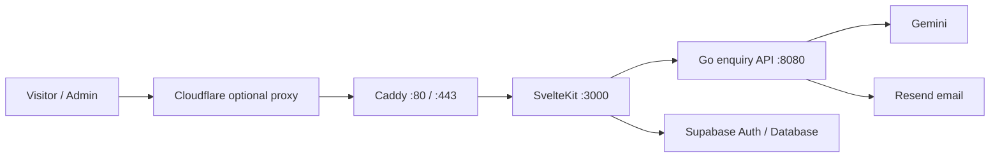

# Docker architecture and operations

Docker is the primary deployment method for InceptChange. The complete application runs as three services: SvelteKit/Node, Go enquiry API, and Caddy HTTPS proxy. Supabase, Gemini and Resend remain managed external services. This setup does not create a second Supabase database or migrate existing customer data.

## Architecture



| Service | Image | Host ports | Persistent data |
| --- | --- | --- | --- |
| web | Multi-stage Node 22 build | None in production | Assets packaged in image |
| api | Static Go executable, Alpine runtime | None | None; bookings are in Supabase |
| proxy | Caddy 2 | 80 and 443 TCP | caddy_data and caddy_config volumes |

Two Docker networks keep the Go API separate from the proxy. Only web can reach api by service name. Both application containers run as non-root users with read-only filesystems, a writable temporary directory, dropped capabilities, memory/PID limits, health checks and graceful shutdown. Docker rotates container logs at 10 MB per file, keeping three files per service. Images use maintained major-version base tags; rebuild with --pull during planned updates for base security fixes. Pin image digests if your release process requires identical base images across rebuilds.

The web Dockerfile builds and checks the website, generates responsive WebP images, and copies only runtime dependencies/output into the final image. The Go build runs tests/vet, strips development/debug paths and produces a static executable. .dockerignore excludes private environment files, Git metadata and local build/dependency folders. Secrets are injected at runtime and must never be build arguments.

## Files

| File | Purpose |
| --- | --- |
| Dockerfile | Website build/runtime |
| backend/Dockerfile | Go build/runtime |
| compose.yaml | Shared services/network/resource settings |
| compose.local.yaml | Local-only website port |
| compose.production.yaml | Canonical origin and HTTPS proxy |
| docker/Caddyfile | HTTPS, redirect, streaming, compression and asset caching |
| docker/web.env.example | Website environment template |
| docker/api.env.example | Go environment template |
| scripts/docker_env.py | Generate private runtime files from existing local settings |
| scripts/docker_deploy.sh | Build and apply a release on the already migrated VPS |

## Install Docker

Use Docker Desktop on Windows/macOS, with Linux containers enabled. Windows users should enable the WSL2 backend. Docker Engine plus the Compose plugin is used on the VPS and other Linux hosts. Official instructions:

- https://docs.docker.com/desktop/setup/install/windows-install/
- https://docs.docker.com/desktop/setup/install/mac-install/
- https://docs.docker.com/engine/install/ubuntu/

On Ubuntu 24.04, after copying this repository to the server, install from Docker's signed official package repository:

```sh
sudo bash scripts/install_docker_ubuntu.sh
```

The installer enables Docker at boot and does not reboot the VPS or stop your current website. If Ubuntu has conflicting Docker/containerd packages from another source, review the official Docker instructions before replacing them.

Verify after starting Docker:

```sh
docker version
docker compose version
```

On Linux, use sudo for Docker commands unless your account already has daemon access. Docker daemon/group access is effectively root access. Avoid exposing the Docker socket to the application containers.

## Local startup — Windows, macOS and Linux

From the repository root, either import your existing configuration:

```sh
python3 scripts/docker_env.py
```

On Windows use `py -3 scripts/docker_env.py`. This writes docker/web.env and docker/api.env with only the necessary settings. It does not copy ADMIN_PASSWORD. A generated shared secret is used only if neither source file has one. Do not run this over intentionally different production configuration.

Or copy and edit the examples manually, which avoids requiring Python:

```sh
cp docker/web.env.example docker/web.env
cp docker/api.env.example docker/api.env
```

PowerShell equivalents:

```powershell
Copy-Item docker/web.env.example docker/web.env
Copy-Item docker/api.env.example docker/api.env
notepad docker/web.env
notepad docker/api.env
```

Use the same ENQUIRY_PROXY_SECRET in both files. Configure Supabase keys and ADMIN_EMAILS in web.env, and Gemini/Resend credentials in api.env. Admin passwords belong to Supabase Auth, not Docker. Apply both SQL migrations to your existing Supabase project and create the allowlisted admin user as described in docs/ADMIN.md.

Restore ignored local assets before building: static/images/ShowReel.mp4 and studio source photos in static/images/studio/. They are packaged by the build and are not pulled from Git. Generated WebP filenames include a content hash; changing a source photo produces a new cached URL.

Start the full application stack locally:

```sh
docker compose -f compose.yaml -f compose.local.yaml up --build -d --wait
docker compose -f compose.yaml -f compose.local.yaml ps
```

Open http://localhost:5173 and http://localhost:5173/admin/login. The Go API has no public port. Node/Go installation is not required on the host because the images build them. Docker local mode runs a production-style build rather than hot reload.

To use port 5175, set LOCAL_PORT before the same commands:

```sh
export LOCAL_PORT=5175
```

PowerShell: `$env:LOCAL_PORT='5175'`. Use localhost rather than 127.0.0.1 in the browser because same-origin checks use the configured localhost origin. The local override disables trusted client-IP headers; production requests receive them from Caddy.

View logs and stop:

```sh
docker compose -f compose.yaml -f compose.local.yaml logs --tail=100 -f
docker compose -f compose.yaml -f compose.local.yaml down
```

For source edits, run up --build again. For private environment edits, run up -d --force-recreate; restarting a container alone does not replace its environment. Standard npm/Go development remains available through start.md.

## Production paths and startup

Server: 15.235.185.226, user ubuntu. Project directory: /opt/inceptchange/docker-project.

```sh
ssh -i ~/.ssh/inceptchange_vps ubuntu@15.235.185.226
cd /opt/inceptchange/docker-project
sudo docker compose -f compose.yaml -f compose.production.yaml ps
```

Private settings live at docker/web.env and docker/api.env within that project and are root-readable/owner-restricted files. Edit with sudoedit. Caddy automatically obtains and renews HTTPS for both domain names. Preserve its named volumes. Production sends no ports for Node or Go to the public network.

The old systemd/host-Nginx deployment is retained as an emergency rollback but should be disabled after a successful migration. Its environment and code files are not the active Docker release. The old Certbot timer is disabled because Caddy owns renewal. Do not run both host Nginx and Caddy on ports 80/443.

Cloudflare DNS root and www point to this VPS. Use Full (strict) SSL mode with orange proxy. Caddy trusts only the configured official Cloudflare address ranges for forwarded client IPs, and applies strict proxy parsing. Direct origin requests cannot override their client address with an arbitrary header. Keep those ranges current when Cloudflare changes them.

## Uploading and deploying a change

A Git commit/push updates the repository, not production. Review and commit changes as usual. Create a source archive locally including ignored studio photos, but exclude all private files and dependency/build folders:

```sh
COPYFILE_DISABLE=1 tar --exclude=.git --exclude=.agents --exclude=.codex --exclude=node_modules --exclude=.svelte-kit --exclude=build --exclude=.env --exclude=backend/.env --exclude='docker/*.env' --exclude=static/images/ShowReel.mp4 -czf /tmp/inceptchange-source.tar.gz .
scp -i ~/.ssh/inceptchange_vps /tmp/inceptchange-source.tar.gz ubuntu@15.235.185.226:/tmp/
```

On Linux/macOS the COPYFILE_DISABLE flag prevents macOS metadata files from entering the archive. On Windows omit that prefix and use tar.exe, `$env:TEMP/inceptchange-source.tar.gz` and `$env:USERPROFILE/.ssh/inceptchange_vps`. Do not place the archive inside the repository being archived. The example omits the unchanged showreel; it must already exist in the server project's static folder. Upload an updated MP4 separately when changing it.

On the VPS:

```sh
cd /opt/inceptchange/docker-project
tar -xzf /tmp/inceptchange-source.tar.gz
rm /tmp/inceptchange-source.tar.gz
sudo bash scripts/docker_deploy.sh
```

The script validates configuration without printing secrets, saves a root-only settings backup, tags existing web/api images as rollback, builds/tests new images, validates Caddy and waits for healthy containers. It does not change database schemas or overwrite environment files. Schema migrations must be applied separately before deploying code that needs them. A failed build leaves running containers unchanged. A failure during replacement may require the rollback below; the script does not claim atomic deployment.

For a base-image refresh, run `sudo docker compose build --pull` before the deployment script. Backups inside `/opt` must not be included in source archives.

## Verification and health

```sh
sudo docker compose -f compose.yaml -f compose.production.yaml ps
sudo docker compose -f compose.yaml -f compose.production.yaml logs --tail=100 web api proxy
curl --fail https://www.inceptchange.com/healthz
curl -I https://www.inceptchange.com/admin/login
curl -I https://inceptchange.com
```

Health checks prove the process responds, not that external Gemini/Resend/Supabase services are available. Test admin login, availability, a complete booking enquiry and both email copies separately. Test bookings should be labelled and deleted afterward. The API health endpoint is available only within Docker; the website health endpoint exposes no secrets and is excluded from indexing.

Check images use image/webp and immutable caching, and AI responses stream rather than waiting for the complete question. Compression uses gzip/zstd for suitable text responses; already compressed WebP/video files remain as encoded assets. Caddy flushes streamed responses immediately.

## Backup and rollback

Keep known-good web/api Docker images, private runtime files, Caddy configuration and volumes. Supabase data requires backups in Supabase; copying Docker volumes does not back up the external database. A source archive alone excludes original secrets and may omit the showreel.

The deployment script maintains one image tag called rollback per application service, replaced on each deployment. For long-lived release history, set RELEASE_TAG to a release ID before building and record that ID with the corresponding source/configuration backup. Do not prune images until the release has been verified.

To restore the previous application images while keeping the proxy/certificates:

```sh
cd /opt/inceptchange/docker-project
sudo env RELEASE_TAG=rollback docker compose -f compose.yaml -f compose.production.yaml up -d --no-build --wait
```

Restore private files/Caddyfile from the selected root-only backup if those changed, then recreate affected containers. Do not use down -v: it deletes certificate volumes. Database migrations are not reverted by image rollback.

Emergency return to the legacy deployment (only while those files remain intact):

```sh
sudo docker compose -f compose.yaml -f compose.production.yaml down
sudo systemctl enable --now inceptchange-site inceptchange-enquiry nginx
sudo systemctl enable --now certbot.timer
```

The legacy code/config may be older. Confirm its credentials and public behavior before relying on it.

## Maintenance and troubleshooting

- Container unhealthy: inspect logs and `docker inspect --format '{{json .State.Health}}' CONTAINER_NAME`.
- Port 80/443 in use: inspect `sudo ss -ltnp`; stop the old host proxy only during the planned cutover.
- TLS failure: check DNS, Cloudflare SSL mode, public ports and proxy logs. Certificates live in the Caddy volumes.
- Permission errors: ensure runtime env files are readable by Docker's daemon and local asset files are readable in the build context. Runtime application root filesystems are intentionally read-only.
- Gemini fallback: check api logs and provider quota/model settings; email and booking submission remain independent.
- Calendar/schema failure: confirm Supabase migrations and private secret key, not a browser key.
- Disk growth: inspect `sudo docker system df` and rotated logs/backups. Never delete active volumes indiscriminately.

Use `sudo docker compose ... exec proxy caddy reload --config /etc/caddy/Caddyfile --adapter caddyfile` after editing only the Caddyfile. Use compose up -d --force-recreate after environment edits. Keep UFW allowing SSH and ports 80/443; Docker publishing can bypass some host firewall rules, so never add public web/api database ports casually.

Reference documentation: https://docs.docker.com/compose/ and https://caddyserver.com/docs/automatic-https.

## Certificate volume backups

On the VPS, back up Caddy data into a root-only directory. The archive contains TLS private keys:

```sh
sudo mkdir -p /opt/inceptchange-private-backups
sudo chmod 700 /opt/inceptchange-private-backups
sudo docker run --rm -v inceptchange_caddy_data:/data:ro -v /opt/inceptchange-private-backups:/backup alpine:3.22 tar -czf /backup/caddy-data.tar.gz -C /data .
sudo chmod 600 /opt/inceptchange-private-backups/caddy-data.tar.gz
```

For a consistent recovery snapshot, take this while the proxy is stopped during a maintenance window, then start it again. Keep private backups outside the repository and public web directories. Preserve docker/web.env, docker/api.env and the source/showreel separately. Supabase backups are managed in Supabase.

## Continuous integration

.github/workflows/ci.yml checks the frontend, builds it, runs Go tests/vet and the mock admin integration tests on pushes and pull requests. No provider credentials are required. CI intentionally does not claim to verify ignored production media or external services; the actual Docker release build and live smoke checks cover those. It does not deploy automatically.

## First migration from the legacy server

This procedure has already been completed on the current VPS. For a comparable legacy deployment, keep the old website running while building Docker images and testing on a loopback port:

```sh
cd /opt/inceptchange/docker-project
sudo docker compose build
sudo env LOCAL_PORT=13000 docker compose -f compose.yaml -f compose.local.yaml up -d --no-build --wait
curl --fail http://localhost:13000/healthz
sudo docker compose -f compose.yaml -f compose.production.yaml run --rm --no-deps proxy caddy validate --config /etc/caddy/Caddyfile --adapter caddyfile
```

From your computer, `ssh -i ~/.ssh/inceptchange_vps -L 13000:127.0.0.1:13000 ubuntu@15.235.185.226` allows testing at http://localhost:13000 without exposing staging publicly. Test admin/database/AI before cutover. Back up legacy files and private settings, then:

```sh
sudo systemctl stop nginx
sudo docker compose -f compose.yaml -f compose.production.yaml up -d --no-build --wait --wait-timeout 120
curl --fail https://www.inceptchange.com/healthz
sudo systemctl disable --now nginx inceptchange-site inceptchange-enquiry certbot.timer
```

Caddy may need a short period to obtain the first certificate. If startup or HTTPS fails, bring Docker down and restart the legacy services immediately. After migration, do not run compose.local.yaml on the production project: both overrides use the same project name, so it would replace the live web service with a localhost origin.
